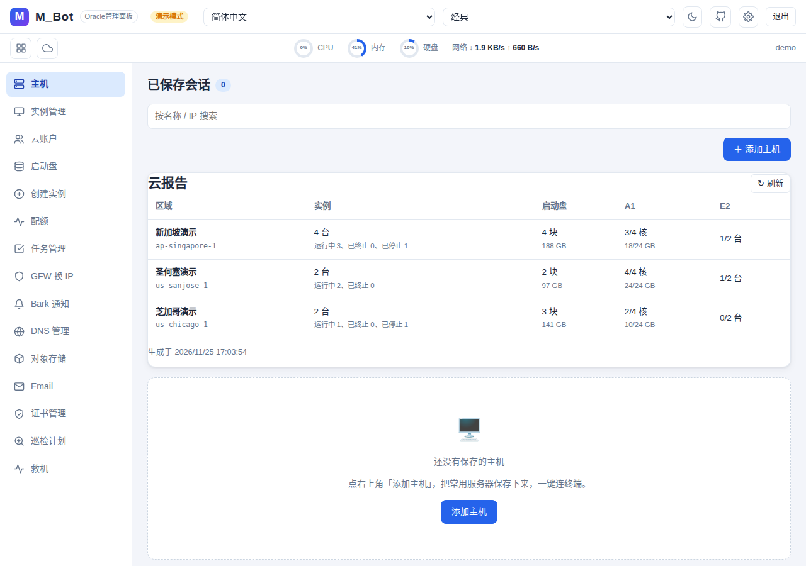
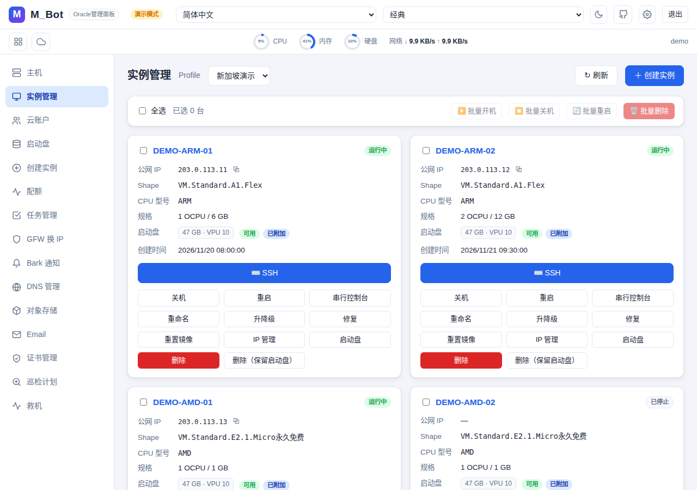
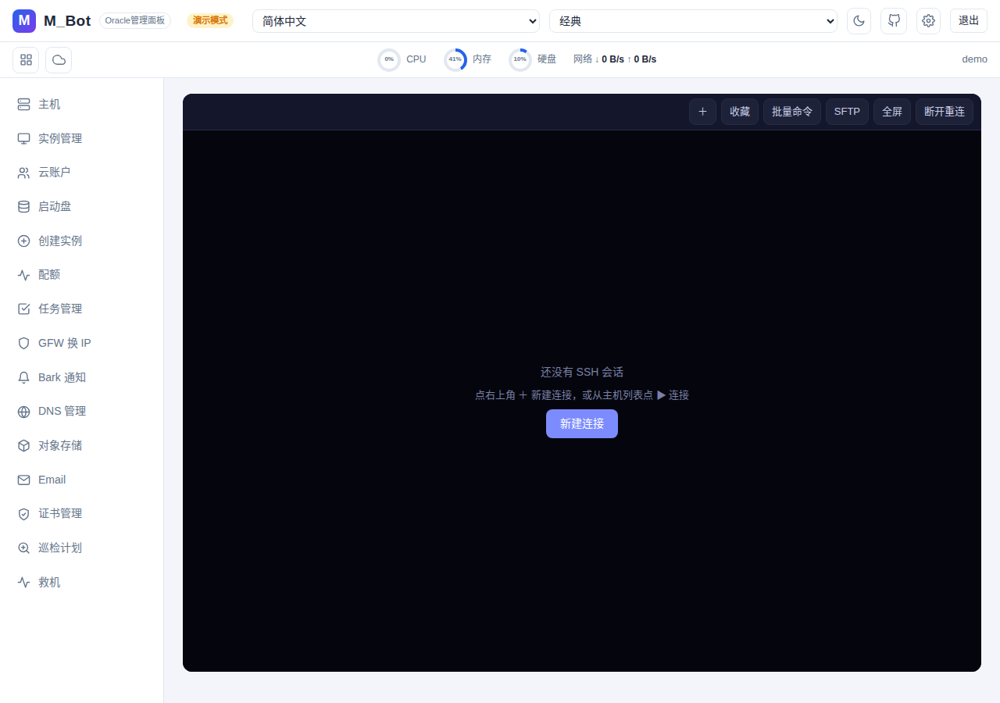
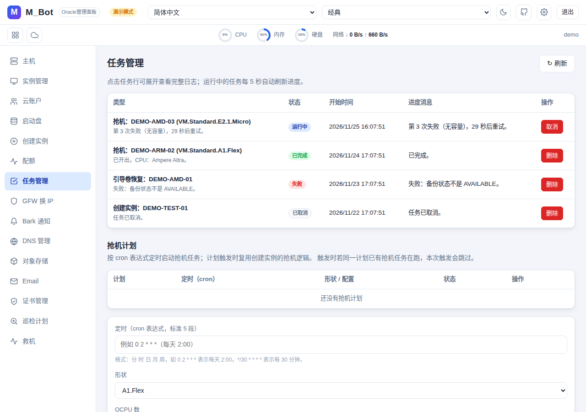

# M_Bot Oracle开源管理面板

> **当前版本：v2.14.2** · 更新记录见 [CHANGELOG.md](CHANGELOG.md)（[英文版 / English](CHANGELOG.en.md)）

[中文](#中文) | [English](#english)

---

## 中文

M_Bot 是一个开源的 Oracle Cloud 管理面板：Telegram 机器人 + Web 面板 + Web SSH +
抢机 + Cloudflare DNS + MCP 服务器。代码全部独立编写、全部可见、可审计。

> ⚠️ 免责：本项目是独立开发的开源项目，与任何同类闭源工具无任何关联，
> 不共享代码。

**核心亮点：**

- **安全与独立**：纯自研代码、3250 个单元测试；OCI 私钥只在本地做请求签名，不外传；免费功能全开，无付费墙。
- **多端协同**：Telegram 机器人 + FastAPI Web 面板 + MCP 协议接入，配置与通知（Telegram + Bark 加密推送）打通。
- **省心运维**：终止实例默认连带删引导卷防扣费；RIPE Atlas 探针自动换被墙 IP；Let's Encrypt 域名与 IP 证书自动签发/续期。

适用场景：一台 Oracle Cloud 免费套餐服务器，用机器人或网页管实例、抢机、换 IP、做 DNS，不用再开控制台。

### 快速开始

准备工作（缺一不可）：
1. 一台 Debian / Ubuntu 服务器（root 权限，1 核 1GB 以上即可）。
2. Telegram 机器人 Token：见下面「拿到 Telegram 机器人 Token（详细步骤）」。
3. 你的 Telegram 用户 ID：找 @userinfobot 发 `/start` 拿到（纯数字）。
4. OCI API 密钥：见下面「拿到 OCI API 密钥（详细步骤）」。

### 🚀 一条命令安装

准备工作就绪后，一条命令装好（root 运行；首次运行是安装，再次运行是更新并重启）：

```bash
wget -O install.sh https://raw.githubusercontent.com/jimu2000/M_Bot/main/install.sh && chmod +x install.sh && bash install.sh
```

安装时会问你 Token、用户 ID、面板密码（留空自动生成 16 位随机密码，只显示一次）、域名（留空则自动申请 IP 证书）。装完后：

- 有域名：打开 `https://你的域名/login`（Let's Encrypt 证书，自动申请）。
  安装时选验证方式：`http`（80 端口验证，默认）或 `cfdns`（Cloudflare
  DNS 验证，需 CF API Token，要有 Zone:DNS:Edit + Zone:Zone:Read 权限；
  验证不占端口，443 被别的服务占了时面板改走 9527 端口）。
- 没域名：自动用服务器公网 IP 申请 Let's Encrypt IP 证书（shortlived，
  有效期约 6 天，cron 每 2 天自动续期），打开 `https://服务器IP:9527/login`
  （正规证书，浏览器不报警；申请失败时回落自签证书，浏览器提示不受信任
  时点"继续访问"；IP 证书验证要走 80 端口，云上安全组要放行 80）。
- 用户名 `admin`，密码是你输入的或自动生成的（存在 `/root/.mbot-admin-password`）。

管理命令：`bash install.sh start|stop|restart|status|log|upgrade|uninstall`。

下面是 Token 与 OCI 密钥的详细获取步骤，装好后按提示导入即可。

### 拿到 Telegram 机器人 Token（详细步骤）

Token 是机器人调用 Telegram Bot API 的通行证，格式是一串数字 + 冒号 +
一串字母数字，例如 `123456789:AAH...`（35 字符左右）。冒号前面那串数字
是机器人的 ID，不用单独填；安装时整串 Token 一起填。

**新建机器人（还没有机器人时）：**

1. 打开 Telegram，搜索 @BotFather，点 Start。
2. 发 `/newbot`。
3. 起个显示名（比如 M-探长）。
4. 起个用户名，必须以 `bot` 结尾（比如 `vega_oci_bot`），不能跟别人重复。
5. BotFather 回一条消息，里面就是 Token，整串复制下来。

**已有机器人（想找回 Token 时）：**

1. 打开 @BotFather，发 `/token`。
2. 选择你的机器人。
3. BotFather 会把 Token 发给你，整串复制下来。

**你的 Telegram 用户 ID（白名单用，别跟 Token 混了）：**

找 @userinfobot 发 `/start`，它回你的纯数字 ID，安装时填进用户 ID 那一栏；
只有这个 ID 能操作机器人。

**Token 泄露了怎么办：**

在 @BotFather 里 `/mybots` → 选你的机器人 → API Token → Revoke，
重新生成一串新的，旧的立即失效。

**注意：** Token 谁拿到谁就能控制你的机器人，不要发到群聊、不要贴到公开地方。

**注意：** 同一个 Token 只在一台机器上跑一个机器人。两台机器用同一个 Token 会互相抢消息，命令随机分到其中一台，另一台的配置缺失时就报错；测试用的第二台机器请新建一个机器人、拿新的 Token。

### 拿到 OCI API 密钥（详细步骤）

OCI API 密钥分两样东西，走两条路，别混了：

- **config 文本**（含 tenancy / user / fingerprint / region / key_file
  五个键）：发给你**自己的机器人**（私聊，不是群、不是发给任何人），
  机器人装在你自己的服务器上，配置只落在你自己的机器上。
- **私钥文件**（.pem）：**不要经 Telegram 发**，用 scp 直接传到服务器。

**第 1 步：生成密钥对（在你电脑或服务器上）：**

```bash
openssl genrsa -out oci_api_key.pem 2048
chmod 600 oci_api_key.pem
openssl rsa -pubout -in oci_api_key.pem -out oci_api_key_public.pem
openssl rsa -pubout -outform DER -in oci_api_key.pem | openssl md5 -c
```

最后一行输出的就是指纹（fingerprint），格式如 `aa:bb:cc:...`，记下来，
第 3 步要用。

**第 2 步：把公钥加到 OCI 控制台：**

1. 登录 OCI 控制台（cloud.oracle.com）。
2. 右上角头像 → My Profile（我的资料）→ API Keys（API 密钥）→ Add API Key。
3. 粘贴**公钥**文件（`oci_api_key_public.pem`，以 `-----BEGIN PUBLIC KEY-----`
   开头的那份）的内容，点 Add。
4. 控制台会显示指纹，跟第 1 步的指纹对一下，一致就对了。

**第 3 步：拿到 tenancy OCID 与 user OCID：**

- user OCID：在 My Profile 页上，格式 `ocid1.user.oc1...`。
- tenancy OCID：头像菜单 → 租户名 → OCID，格式 `ocid1.tenancy.oc1...`。

**第 4 步：写 config 文本：**

```ini
[DEFAULT]
user=ocid1.user.oc1..xxxx
fingerprint=aa:bb:cc:dd:ee:ff:00:11:22:33:44:55:66:77:88:99
key_file=/root/oci_api_key.pem
tenancy=ocid1.tenancy.oc1..xxxx
region=ap-singapore-1
```

region 写你的主区域（新加坡 `ap-singapore-1`、圣何塞 `us-sanjose-1`、
芝加哥 `us-chicago-1`）。多账号就多写几个段（`[ACCOUNT2]`、`[ACCOUNT3]`
……），一次全导进去；R-Bot 格式的 `oci=begin` / `oci=end` 块也支持。

key_file 写私钥在服务器上的实际路径就行：直接放 `/root/` 下就写
`/root/oci_api_key.pem`；用 `oci setup config` 生成的密钥默认在
`~/.oci/oci_api_key.pem`（即 `/root/.oci/oci_api_key.pem`），写这个路径
也行，不用挪地方——只要在 `/root` 下面，机器人都原样保留。

**第 5 步：config 发给机器人，私钥 scp 到服务器：**

- config：打开你自己的机器人私聊，发 `/uploadapi`，然后发 config 文件
  （.txt / .conf）或直接粘贴文本，按提示确认，机器人会写到服务器的
  `~/oci_config`（即 `/root/oci_config`）。找不到自己的机器人？在 Telegram
  搜索框搜它的 @用户名（建机器人时起的、以 bot 结尾的那个），或在 @BotFather
  里 `/mybots` → 选你的机器人 → 点 @用户名打开，也可以直接开
  `t.me/<用户名>`。注意：机器人要先装好 M_Bot
  （安装时填了这个 Token）才会回消息，没装好之前发了也没反应。如果服务器上
  还有旧的 `~/.oci/config`，不用管它——M_Bot 优先读 `~/oci_config`，只有它
  不存在时才读旧文件。
- 私钥：用 scp 直接传到服务器（改过 SSH 端口的加 `-P 端口`）：

```bash
scp oci_api_key.pem root@<服务器IP>:/root/oci_api_key.pem
```

key_file 如果已经在 `/root` 下，机器人保留原路径；否则自动改成
`/root/<PROFILE>.pem`，scp 时按提示的路径放。

**第 6 步：验证：**

机器人里发 `/oracle`，能列出账号和实例就是通了。安装命令见上面「🚀 一条命令安装」。

### 界面预览

在线演示（免登录，模拟数据）：https://demo.youu.eu.org






### 功能

**OCI 核心（`oci/`，调官方 OCI CLI，不用 SDK）**
- 实例：列表 / 详情 / 创建 / 启动 / 停止 / 重启 / 终止（默认同时删除引导卷，
  防扣费）/ 改名 / 升降配 / 重装系统 / 串行控制台
- 批量操作：批量启动 / 停止 / 重启 / 删除
- 网络：换公网 IP、保留 IP 管理、IPv6 创建 / 删除 / 列表
- 磁盘：启动盘列表 / 扩容 / 删除 / 孤儿盘清理 / VPU 修改
- 配额：免费额度汇总、A1 配置体检、开机前配额预检（`can_launch`）
- 对象存储：Bucket 创建 / 删除 / 对象上传 / 下载 / 列表
- 邮件服务：Email Delivery 发件人管理
- 抢机（`grabber.py`）：`--no-retry` 快速失败、随机抖动间隔、429 指数退避、
  配额不足检测（停机并通知，不无限重试）、CPU 型号筛选（如只留 AMD EPYC 7J13）

**Telegram 机器人（`tgbot/`，python-telegram-bot）**
- `/oracle` 菜单 45 项：开机抢机、IP 管理、实例管理、磁盘管理、云账户、
  监控通知、配额、流量、费用、批量操作、A1 体检、流量守护、停机保活、
  SSL 到期提醒、对象存储、Email 发件人、抢机计划、Oracle 全球区域测速、
  Cloudflare 优选 IP……
- GFW 自动换 IP（菜单 16）：每 30 分钟从中国大陆探针（RIPE Atlas）
  ping 已开启的实例公网 IP，被墙自动换 IP 再检测，直到换到可用的为止；
  每次换 IP 发双通道通知（TG + Bark，没设 Bark 就只发 TG）
- 开机默认生成 UUID root 密码（32 位十六进制），确认页就显示给用户，
  抢机成功后 Telegram + Bark 双通道通知里带密码（网页版开机同样双通道
  通知，提交后弹窗显示一次密码）
- Bark 通知设置（菜单 43 / `/bark` 命令 / 面板“Bark 通知”页，三端共用
  同一份配置）：AES-256-CBC 加密推送，地址 + 32 位 Key + 测试推送 + 开关；
  Key 可一键自动生成（32 位随机 hex），生成后附二维码，Bark App 扫码添加
- `/domain`：Cloudflare Zone 与 DNS 记录查询
- 客户端工具：`/command` 远程 Shell（危险命令黑名单）、`/pubkey` 公钥管理、
  `/oproxy` 代理设置、`/uploadapi` 上传 OCI 配置
- 白名单硬规则：非白名单用户任何命令直接拒绝；定时任务：实例监控、
  每日报告、SSL 到期检查

**Web 面板（`web/`，FastAPI + WebSocket + Paramiko + xterm.js）**
- 登录（pbkdf2 哈希、失败锁定翻倍最长 30 分钟、图形验证码可选、
  Telegram 验证码登录可选）
- 页面：总览 / 实例 / 云账户 / 创建实例 / 配额 / 启动盘 / 任务 / GFW 换 IP /
  Bark 通知 / 终端 / DNS 管理 / 对象存储 / 邮件服务 / 证书管理 / 巡检计划 /
  云报告
- 云账户页添加租户：粘贴 config 文本或上传 config 文件自动解析（支持 R-Bot
  格式、一次多个账号），已存在的账号自动过滤；私钥文件（.pem）在确认步骤
  直接上传（内容校验必须是私钥、600 权限保存、路径强制在 home 下），
  不经过 Telegram；配置里的 [cloudflare] 段一并保存；compartment 环境变量
  自动补写；新账号重启机器人与面板后生效
- IAM 用户管理（云账户页，机器人菜单 8 同步）：列出 IAM 用户、新增普通用户、
  创建 Bot 专用 API 用户（自动建组与策略）、新增 API Key（私钥只显示一次）、
  重置控制台临时密码、删除用户；新建用户/新增 API Key 后生成可直接用的 OCI
  配置文件（可下载 oci_config.txt，粘贴到“添加租户”即用）；删除保护：禁删
  当前 API 用户、禁删最后一个管理员
- 创建实例：可用域与子网按所选账号自动填充（来自部署配置），SSH 公钥文件
  有上传就填、没有就留空（可选项，只靠 root 密码登录也能开机）
- 多区订阅二级菜单：实例 / 启动盘 / 配额 / 创建 / GFW 页的账号下拉旁有
  区域下拉（多区账号才显示），切换区域后数据按新区域加载，切换账号时
  区域重置为主区
- Web SSH：多标签、断线重连 + 快照回放、会话挂起、空闲清理
- SFTP 文件面板：列表 / 下载 / 上传（分块上传带进度）/ 新建目录 / 删除 /
  重命名 / 在线编辑，三层路径穿越防护
- 批量命令、终端收藏夹、抢机计划（cron 调度）、OCI 代理设置

**Cloudflare DNS（`clouds/cloudflare.py`）**
- Zone 列表、DNS 记录增删改查、代理开关、SSL 证书到期检查

**MCP 服务器（`mcp_server.py`，标准库 JSON-RPC over stdio，零新增依赖）**
- 6 个工具：列实例、实例详情、配额、免费额度汇总、列 Zone、列 DNS 记录

**其他云**：`clouds/` 下有 AWS / GCP / Azure / DigitalOcean / SolusVM 的
抽象接口与 stub（待实现，需对应云账号才能真实验证）。

### GFW 自动换 IP（菜单 16，v1.10.0 新增）

代理服务器的公网 IP 被墙后，国内客户端就连不上了。这个功能自动盯着它：

- **检测**：每 30 分钟用 [RIPE Atlas](https://atlas.ripe.net) 从中国大陆
  探针（电信/联通/移动混合，5 个探针各发 3 个 ping 包）ping 已开启的实例
  公网 IP；上报探针少于 3 个时结论为“未知”，不换 IP；多数探针不通即判定被墙。
- **换 IP**：被墙就自动换 IP（先删旧临时 IP 再绑新保留 IP），换完重新检测；
  新 IP 还是被墙就继续换；单轮最多换 5 次，换满仍被墙就暂停，等下个周期。
- **通知**：每次换 IP 都发双通道通知（Telegram + Bark）；Bark 是可选项，
  没设置就只发 Telegram。本来就正常时不发通知，不打扰。
- **开关**：逐台开启/关闭（机器人菜单 16 或面板“GFW 换 IP”页，两边共用配置）；
  也可以点“立即检查”马上测一次。

设置 RIPE Atlas API Key（一次，免费）：

1. 在 [atlas.ripe.net](https://atlas.ripe.net) 注册账号（RIPE NCC Access 账号）；
2. 在 My Credits 页面点 **Claim 50,000 free credits** 领 5 万免费积分
   （一次检测约几十积分，够用几个月；长期用可以在自己服务器上跑一个
   RIPE Atlas 软件探针，每天赚约 2 万积分）；
3. 在 [Keys 页面](https://atlas.ripe.net/keys/) 创建一个
   “create a new user-defined measurement” 类型的 Key；
4. 把 Key 发给机器人（菜单 16 → 设置 API Key）或填到面板“GFW 换 IP”页。
   Key 只存服务器本机（`tgbot/data/gfw.json`，0600），不回显、不记日志。

为什么选 RIPE Atlas：itdog 自 2026-10 起任务端点强制点选人机验证，
无人值守的定时监控没法用；17CE / BOCE 的官方 API 要账号 + 付费积分；
Atlas 是 RIPE NCC 的正规免费服务，有稳定 REST API。注意：ping 不通
不等于百分百被墙（也可能是线路问题），这里的结论是“疑似被墙”；
实例本身必须回 ping（ICMP 没被安全组禁掉），否则检测永远是“被墙”。

### 手动安装

推荐先用上面的一键安装；手动安装适合想自己掌控每一步的情况，步骤如下：

```bash
git clone https://github.com/jimu2000/M_Bot.git
cd M_Bot
python3 -m venv venv && source venv/bin/activate
pip install -r requirements.txt
pip install oci-cli          # OCI 调用走官方 CLI
```

**1. 配 OCI 认证**（三种方式任选其一，推荐第一种）：

```bash
# 方式一：oci setup config 交互生成（推荐）
oci setup config
# 方式二：手写 ~/oci_config，填 user / fingerprint / tenancy / region / key_file
```

方式一生成的是旧路径 `~/.oci/config`，M_Bot 会自动兼容读取；首次用 `/uploadapi` 导入新账号时会迁移到 `~/oci_config`。

`~/oci_config` 里还可以加 `[cloudflare]` 段放 Cloudflare 凭据（`cf_token`，或 `cf_key` + `cf_email`），机器人 `/domain` 与面板 DNS 页会用它；安装时选 `cfdns` 证书验证也会先读它。凭据优先级：机器人/面板里保存的 > OCI 配置 `[cloudflare]` 段 > 环境变量。

API 私钥（key_file）说明：私钥文件是 OCI 控制台生成的 `.pem` 文件，下载后放到
服务器上，例如 `/root/1.pem`（路径可自定），权限设 600。
获取方法：OCI 控制台 → 右上角用户头像 → My Profile → API Keys →
Add API Key → Generate API Key Pair → 下载私钥与配置文件片段。
也可以用命令生成：`openssl genrsa -out /root/1.pem 2048`，再把公钥贴到控制台添加。

**2. 配环境变量**（部署值一律走环境变量，不写进代码）：

```bash
# 必填：根 compartment（即 tenancy OCID），多账号时各填一个
export MBOT_COMPARTMENT_DEFAULT="ocid1.tenancy.oc1..xxxxxxxx"
export MBOT_COMPARTMENT_ACCOUNT2="ocid1.tenancy.oc1..xxxxxxxx"   # 可选
export MBOT_COMPARTMENT_ACCOUNT3="ocid1.tenancy.oc1..xxxxxxxx"   # 可选
# 镜像 OCID（创建实例用，各区域不同，用 oci compute image list 查）
export MBOT_IMAGE_AARCH64="ocid1.image.oc1..xxxxxxxx"
export MBOT_IMAGE_X86_64="ocid1.image.oc1..xxxxxxxx"
# Telegram 机器人（用机器人时填）
export MBOT_TELEGRAM_TOKEN="123456789:xxxxxxxxxxxxxxxxxxxxxxxxxxxxxxxxxxx"
export MBOT_ALLOWED_USERS="123456789"   # 你的 Telegram 用户 ID，逗号分隔多个
# Web 面板（用面板时填）
export MBOT_WEB_PASSWORD_HASH="$(python3 -c "import hashlib,os;print(hashlib.pbkdf2_hmac('sha256',b'你的密码',os.urandom(16),100000).hex())")"
export MBOT_WEB_SECRET="$(openssl rand -hex 32)"
# 可选：OCI CLI 路径、Cloudflare 凭据、串行控制台 SSH 公钥
export MBOT_OCI_CLI="/opt/rbot-clone/venv/bin/oci"
export CF_API_TOKEN="xxxxxxxxxxxxxxxxxxxxxxxxxxxxxxxxxxxxxxxx"
export MBOT_CONSOLE_SSH_KEY_FILE="/opt/rbot-clone/web/data/console_rsa.pub"
```

**3. 启动**：

```bash
# Telegram 机器人
python3 -m tgbot.bot
# Web 面板（默认只绑 127.0.0.1:9527，用 SSH 隧道访问）
uvicorn web.app:app --host 127.0.0.1 --port 9527
# MCP 服务器（stdio，供 Claude Desktop 等客户端调用）
python3 mcp_server.py
```

生产部署建议用 systemd 托管两个服务，见 `docs/deployment.md`
（含原子升级脚本 `scripts/deploy.sh`）。

### 配置规范

- **配置区在文件顶端**：每个模块的常量、阈值、路径都在文件开头的配置区，
  改配置不用翻代码。
- **部署值走环境变量**：compartment、镜像 OCID、子网、安全组、Token、密码哈希
  一律从环境变量注入，源码里只有占位符（如 `ocid1.tenancy.oc1..xxxxxxxx`）。
- **私钥只在本地用**：OCI 私钥只交给官方 OCI CLI 做本地请求签名，代码不读、
  不打印、不外传。

### 测试

```bash
python3 -m unittest discover -s tests -t .
# Ran 3250 tests ... OK
```

3250 个单元测试（mock 为主，写操作零次碰生产）。真实 API 验证记录见
`docs/verification*.md`：只读操作对真实 OCI / Cloudflare API 实测通过；
写操作（创建 / 换 IP / 升降配 / 扩容 / 释放等）在测试实例上真实跑通过。

### 项目结构

```
M_Bot/
  oci/          OCI 客户端（client/instance/network/volume/quota/grabber/email/objectstorage）
  tgbot/        Telegram 机器人（bot/handlers/handlers_extra/keyboards/services/monitoring）
  web/          Web 面板（FastAPI 路由、Web SSH、SFTP、任务调度）
  clouds/       Cloudflare 客户端 + 其他云抽象接口与 stub
  mcp_server.py MCP 服务器（JSON-RPC over stdio）
  scripts/      部署脚本（原子升级）
  tests/        单元测试（3250 个）
  docs/         设计与验证文档
```

### 明确不做的功能

- 付费权益体系（充值、权益开关）——对应功能（IAM 用户管理、用量统计、
  多 profile 管理等）全部免费开放
- 删除当前 API（等于机器人自杀）
- 禁用被封账户（不可逆操作，建议人工处理）

---

## English

M_Bot is an open-source Oracle Cloud management panel written in Python:
Telegram bot + web panel + web SSH + instance grabber + Cloudflare DNS + MCP
server. All code here is independently written, fully visible and auditable.

> ⚠️ Disclaimer: This project is an independent open-source project, not
> affiliated with any similar closed-source tool in any way, with no
> shared code.

**Highlights:**

- **Secure and independent**: independently written code, 3250 unit tests; the OCI private key only signs requests locally and is never sent out; every free feature is open, no paywall.
- **Multi-client**: Telegram bot + FastAPI web panel + MCP server, with shared config and notifications (Telegram + encrypted Bark push).
- **Low-maintenance**: terminating an instance deletes its boot volume by default (no surprise charges); RIPE Atlas probes auto-swap a firewalled IP; Let's Encrypt domain and IP certificates are issued and renewed automatically.

Use case: run one Oracle Cloud Always Free server and manage instances, grab capacity, swap IPs and do DNS from a bot or a web page, without opening the console.

### Quick start

Prerequisites (all required):
1. A Debian / Ubuntu server (root access, 1 vCPU / 1 GB RAM is enough).
2. A Telegram bot token: see "Getting your Telegram bot token (step by step)" below.
3. Your Telegram user ID: send `/start` to @userinfobot (digits only).
4. An OCI API key: see "Getting your OCI API key (step by step)" below.

### 🚀 One-command install

Once the prerequisites are ready, install with one command (run as root; first run installs, later runs update and restart):

```bash
wget -O install.sh https://raw.githubusercontent.com/jimu2000/M_Bot/main/install.sh && chmod +x install.sh && bash install.sh
```

The installer asks for your token, user ID, panel password (leave empty to
auto-generate a 16-character random password, shown once), and domain
(leave empty to get an IP certificate automatically). After installing:

- With a domain: open `https://your-domain/login` (Let's Encrypt
  certificate, requested automatically). Pick a validation method during
  install: `http` (port-80 validation, default) or `cfdns` (Cloudflare DNS
  validation; needs a CF API token with Zone:DNS:Edit + Zone:Zone:Read;
  validation uses no ports, and the panel moves to port 9527 if 443 is
  already taken by another service).
- Without a domain: a Let's Encrypt IP certificate is requested for the
  server's public IP automatically (shortlived, ~6 days validity, renewed
  by cron every 2 days); open `https://server-IP:9527/login` (a real
  certificate, no browser warning; falls back to self-signed if issuance
  fails — click through the browser warning then; IP validation needs
  port 80 open in the cloud security list).
- Username `admin`; the password is the one you entered or the generated one
  (also saved in `/root/.mbot-admin-password`).

Manage it with: `bash install.sh start|stop|restart|status|log|upgrade|uninstall`.

The detailed steps for the token and the OCI key follow below; import them after installing.

### Getting your Telegram bot token (step by step)

The token is the bot's credential for the Telegram Bot API. It looks like
`123456789:AAH...` (digits, a colon, then letters and digits, about 35
characters). The digits before the colon are the bot's ID — you don't enter
it separately; paste the whole token when installing.

**New bot (if you don't have one yet):**

1. Open Telegram, search for @BotFather, press Start.
2. Send `/newbot`.
3. Pick a display name (e.g. M-探长).
4. Pick a username ending in `bot` (e.g. `vega_oci_bot`); it must be unique.
5. BotFather replies with your token — copy the whole string.

**Existing bot (to retrieve the token):**

1. Open @BotFather, send `/token`.
2. Pick your bot.
3. BotFather sends you the token — copy the whole string.

**Your Telegram user ID (for the allowlist — don't confuse it with the token):**

Send `/start` to @userinfobot; it replies with your numeric ID. Enter that as
the user ID during install; only that ID can operate the bot.

**If your token leaks:**

In @BotFather: `/mybots` → pick your bot → API Token → Revoke to generate a
new one; the old one stops working immediately.

**Note:** anyone with the token can control your bot — never post it in a
group chat or anywhere public.

**Note:** run only one bot per token, on one machine. Two machines sharing
a token compete for updates, so commands land on a random one — and fail
when that machine is missing the config. For a second test machine, create
another bot and use its own token.

### Getting your OCI API key (step by step)

The OCI API key is two things, sent through two different channels — don't
mix them up:

- **The config text** (with the five keys tenancy / user / fingerprint /
  region / key_file): send it to **your own bot** (a private chat — not a
  group, not any person). The bot runs on your own server, so the config
  only ever lands on your own machine.
- **The private key file** (.pem): **never send it through Telegram**;
  copy it to the server with scp.

**Step 1: Generate the key pair (on your computer or server):**

```bash
openssl genrsa -out oci_api_key.pem 2048
chmod 600 oci_api_key.pem
openssl rsa -pubout -in oci_api_key.pem -out oci_api_key_public.pem
openssl rsa -pubout -outform DER -in oci_api_key.pem | openssl md5 -c
```

The last command prints the fingerprint, like `aa:bb:cc:...` — save it,
you'll need it in step 3.

**Step 2: Add the public key in the OCI Console:**

1. Log in to the OCI Console (cloud.oracle.com).
2. Top-right avatar → My Profile → API Keys → Add API Key.
3. Paste the contents of the **public** key file (`oci_api_key_public.pem`,
   the one starting with `-----BEGIN PUBLIC KEY-----`), click Add.
4. The console shows a fingerprint — check it matches the one from step 1.

**Step 3: Get the tenancy OCID and user OCID:**

- User OCID: on the My Profile page, looks like `ocid1.user.oc1...`.
- Tenancy OCID: avatar menu → tenancy name → OCID, looks like
  `ocid1.tenancy.oc1...`.

**Step 4: Write the config text:**

```ini
[DEFAULT]
user=ocid1.user.oc1..xxxx
fingerprint=aa:bb:cc:dd:ee:ff:00:11:22:33:44:55:66:77:88:99
key_file=/root/oci_api_key.pem
tenancy=ocid1.tenancy.oc1..xxxx
region=ap-singapore-1
```

Set region to your home region (Singapore `ap-singapore-1`, San Jose
`us-sanjose-1`, Chicago `us-chicago-1`). For more accounts, add more
sections (`[ACCOUNT2]`, `[ACCOUNT3]`, ...); they all import in one go.
R-Bot style `oci=begin` / `oci=end` blocks work too.

Set key_file to the private key's actual path on the server: put the key
directly under `/root/` and write `/root/oci_api_key.pem`; a key generated
with `oci setup config` lives at `~/.oci/oci_api_key.pem` (i.e.
`/root/.oci/oci_api_key.pem`) — write that path, no need to move it. Any
path under `/root/` is kept as-is.

**Step 5: Send the config to the bot, scp the private key to the server:**

- Config: open a private chat with your own bot, send `/uploadapi`, then
  send the config file (.txt / .conf) or paste the text, confirm, and the
  bot writes it to `~/oci_config` on the server (i.e. `/root/oci_config`).
  Can't find your bot? Search Telegram for its @username (the one ending in
  `bot` you picked when creating it), or in @BotFather send `/mybots`, pick
  your bot, and tap its @username — or open `t.me/<username>` directly. Note: the bot only replies after M_Bot
  is installed with its token — before that, it won't respond. If the server
  still has an old `~/.oci/config`, ignore it — M_Bot reads `~/oci_config`
  first and only falls back to the old file when it doesn't exist.
- Private key: copy it to the server with scp (add `-P <port>` if you
  changed your SSH port):

```bash
scp oci_api_key.pem root@<server-IP>:/root/oci_api_key.pem
```

If key_file is already under `/root`, the bot keeps that path; otherwise it
rewrites it to `/root/<PROFILE>.pem` — put the file where it tells you.

**Step 6: Verify:**

Send `/oracle` to the bot; if it lists your accounts and instances, it works. The install command is in "🚀 One-command install" above.

### Screenshots

Live demo (no login, simulated data): https://demo.youu.eu.org


### Features

**OCI core (`oci/`, drives the official OCI CLI, no SDK)**
- Instances: list / detail / create / start / stop / reboot / terminate
  (boot volume deleted by default, so nothing keeps billing) / rename /
  resize / reinstall / serial console
- Batch operations: batch start / stop / reboot / terminate
- Networking: change public IP, reserved IP management, IPv6 create / delete / list
- Volumes: boot volume list / resize / delete / orphan cleanup / VPU change
- Quotas: free-tier summary, A1 shape health check, pre-launch quota check
- Object Storage: bucket create / delete / object upload / download / list
- Email Delivery: sender management
- Grabber (`grabber.py`): `--no-retry` fast fail, jittered intervals,
  exponential backoff on 429, quota-exhaustion detection (stops and notifies
  instead of retrying forever), CPU model filtering (e.g. keep only AMD EPYC 7J13)

**Telegram bot (`tgbot/`, python-telegram-bot)**
- `/oracle` menu with 45 items: launch/grab, IP management, instance
  management, disk management, cloud accounts, monitoring, quotas, traffic,
  costs, batch operations, A1 health check, traffic guard, keep-alive,
  SSL expiry alerts, object storage, email senders, grabber plans,
  Oracle global region speed test, Cloudflare preferred IP…
- GFW auto IP change (menu 16): every 30 minutes, pings enabled instances'
  public IPs from mainland China probes (RIPE Atlas); if blocked, changes
  the IP and re-checks until one works; notifies on every change via
  Telegram + Bark (Bark optional — Telegram only if not configured)
- Boot generates a UUID root password by default (32 hex chars), shown on
  the confirmation page and included in the Telegram + Bark dual-channel
  success notification (web-panel launches notify the same way, and the
  password is shown once in a dialog after submit)
- Bark notification settings (menu 43 / `/bark` command / panel "Bark"
  page, all sharing one config): AES-256-CBC encrypted push, with
  address + 32-char key + test push + on/off switch; the key can be
  auto-generated (random 32-char hex) with a QR code the Bark app scans
- `/domain`: Cloudflare zone and DNS record lookup
- Client tools: `/command` remote shell (dangerous-command blocklist),
  `/pubkey` key management, `/oproxy` proxy settings, `/uploadapi` OCI config upload
- Strict allowlist: non-allowlisted users are rejected on every command;
  scheduled jobs: instance monitoring, daily report, SSL expiry checks

**Web panel (`web/`, FastAPI + WebSocket + Paramiko + xterm.js)**
- Login (pbkdf2 hashing, doubling lockout up to 30 minutes, optional image
  captcha, optional Telegram code login)
- Pages: overview / instances / accounts / create / quota / boot volumes /
  tasks / GFW IP change / Bark notifications / terminal / DNS / object
  storage / email / certificates / inspection plans / cloud report
- Accounts page: add a tenant by pasting config text or uploading a config
  file (auto-parsed, R-Bot format supported, several accounts at once);
  existing accounts are filtered out automatically, and private keys (.pem)
  are uploaded in the confirm step (contents validated as a private key,
  saved with 0600 permissions, path forced under home, never through
  Telegram); a [cloudflare] section in the config is saved too, and
  compartment env vars are added automatically; new accounts take effect
  after restarting the bot and the panel
- IAM user management (accounts page, synced with bot menu 8): list IAM
  users, add users, create a Bot API user (group and policy created
  automatically), add API keys (private key shown once), reset console
  passwords, delete users; creating a user or adding a key also generates
  a ready-to-use OCI config file (downloadable as oci_config.txt, paste it
  into "Add tenant"); deletion guards block removing the current API user
  and the last administrator
- Create instance: the availability domain and subnet auto-fill from the
  deployment config for the selected account, and the SSH key file is
  prefilled when one exists on the server (optional — root password login
  alone is enough to boot)
- Multi-region submenu: the instances / volumes / quota / create / GFW
  pages show a region dropdown next to the account dropdown (multi-region
  accounts only); switching regions reloads the page for the new region,
  switching accounts resets the region to the home region
- Web SSH: multi-tab, reconnect with snapshot replay, session suspend, idle cleanup
- SFTP file panel: list / download / chunked upload with progress / mkdir /
  delete / rename / online edit, three-layer path traversal protection
- Batch commands, terminal favorites, grabber plans (cron scheduling), OCI proxy settings

**Cloudflare DNS (`clouds/cloudflare.py`)**
- List zones, DNS record CRUD, proxy toggle, SSL certificate expiry checks

**MCP server (`mcp_server.py`, stdlib JSON-RPC over stdio, zero new dependencies)**
- 6 tools: list instances, instance detail, quota, free-tier summary,
  list zones, list DNS records

**Other clouds**: `clouds/` has an abstract interface plus stubs for
AWS / GCP / Azure / DigitalOcean / SolusVM (not implemented yet — real
verification needs accounts on those clouds).

### GFW auto IP change (menu 16, new in v1.10.0)

When a proxy server's public IP gets blocked from mainland China, clients
there can't connect. This feature watches for that:

- **Check**: every 30 minutes, pings enabled instances' public IPs from
  mainland China probes via [RIPE Atlas](https://atlas.ripe.net)
  (5 probes, 3 packets each, mixed telecom/unicom/mobile). Fewer than 3
  reporting probes means "unknown" — no action. A majority failing means
  blocked.
- **Change**: on blocked, changes the public IP (delete the old ephemeral
  IP, attach a new reserved one) and re-checks; keeps changing while the
  new IP is still blocked; at most 5 changes per cycle, then pauses until
  the next cycle.
- **Notify**: every IP change sends a dual notification (Telegram + Bark;
  Bark is optional — Telegram only if not configured). Healthy checks stay
  silent.
- **Toggle**: per-instance on/off from menu 16 in the bot or the
  "GFW 换 IP" page in the web panel (shared config).

One-time RIPE Atlas API key setup (free):

1. Register at [atlas.ripe.net](https://atlas.ripe.net) (RIPE NCC Access account);
2. Click **Claim 50,000 free credits** on the My Credits page (one check
   costs tens of credits; for long-term use, run a RIPE Atlas software
   probe on your own server to earn ~21,600 credits per day);
3. Create a key of type "create a new user-defined measurement" on the
   [Keys page](https://atlas.ripe.net/keys/);
4. Send the key to the bot (menu 16 → Set API Key) or paste it on the
   web panel's "GFW 换 IP" page. The key is stored only on the server
   (`tgbot/data/gfw.json`, 0600), never echoed or logged.

Why RIPE Atlas: itdog has forced click-captcha verification on its task
endpoints since 2026-10 (unusable for unattended monitoring), and 17CE /
BOCE require paid credits; Atlas is a free service from RIPE NCC with a
stable REST API. Note that ping failing is evidence of "suspected"
blocking, not proof, and the instance itself must answer ICMP (not
blocked by its security list), otherwise every check reports blocked.

### Manual install

Prefer the one-click install above; manual install is for those who want
to control every step:

```bash
git clone https://github.com/jimu2000/M_Bot.git
cd M_Bot
python3 -m venv venv && source venv/bin/activate
pip install -r requirements.txt
pip install oci-cli          # OCI calls go through the official CLI
```

**1. OCI authentication** (pick one, first recommended):

```bash
# Option 1: interactive setup (recommended)
oci setup config
# Option 2: write ~/oci_config by hand (user / fingerprint / tenancy / region / key_file)
```

Option 1 creates the legacy path `~/.oci/config`, which M_Bot still reads;
the first `/uploadapi` import migrates it to `~/oci_config`.

`~/oci_config` can also hold a `[cloudflare]` section for Cloudflare
credentials (`cf_token`, or `cf_key` + `cf_email`); the bot's `/domain` and
the panel DNS page use it, and the installer reads it first for `cfdns`
certificate verification. Precedence: saved in bot/panel > OCI config
`[cloudflare]` section > environment variables.

API private key (`key_file`): the `.pem` file generated in the OCI console.
Download it to your server, e.g. `/root/1.pem` (any path works), `chmod 600`.
How to get it: OCI console → user avatar (top right) → My Profile → API Keys →
Add API Key → Generate API Key Pair → download the private key and config snippet.
Or generate locally: `openssl genrsa -out /root/1.pem 2048`, then paste the
public key into the console.

**2. Environment variables** (all deployment values come from env vars, never code):

```bash
# Required: root compartment (i.e. tenancy OCID); one per account
export MBOT_COMPARTMENT_DEFAULT="ocid1.tenancy.oc1..xxxxxxxx"
export MBOT_COMPARTMENT_ACCOUNT2="ocid1.tenancy.oc1..xxxxxxxx"   # optional
export MBOT_COMPARTMENT_ACCOUNT3="ocid1.tenancy.oc1..xxxxxxxx"   # optional
# Image OCIDs (for instance creation; differ per region, see oci compute image list)
export MBOT_IMAGE_AARCH64="ocid1.image.oc1..xxxxxxxx"
export MBOT_IMAGE_X86_64="ocid1.image.oc1..xxxxxxxx"
# Telegram bot (if you use it)
export MBOT_TELEGRAM_TOKEN="123456789:xxxxxxxxxxxxxxxxxxxxxxxxxxxxxxxxxxx"
export MBOT_ALLOWED_USERS="123456789"   # your Telegram user ID, comma-separated
# Web panel (if you use it)
export MBOT_WEB_PASSWORD_HASH="$(python3 -c "import hashlib,os;print(hashlib.pbkdf2_hmac('sha256',b'your-password',os.urandom(16),100000).hex())")"
export MBOT_WEB_SECRET="$(openssl rand -hex 32)"
# Optional: OCI CLI path, Cloudflare credentials, serial console SSH public key
export MBOT_OCI_CLI="/opt/rbot-clone/venv/bin/oci"
export CF_API_TOKEN="xxxxxxxxxxxxxxxxxxxxxxxxxxxxxxxxxxxxxxxx"
export MBOT_CONSOLE_SSH_KEY_FILE="/opt/rbot-clone/web/data/console_rsa.pub"
```

**3. Run**:

```bash
# Telegram bot
python3 -m tgbot.bot
# Web panel (binds 127.0.0.1:9527 only; reach it via SSH tunnel)
uvicorn web.app:app --host 127.0.0.1 --port 9527
# MCP server (stdio, for Claude Desktop and similar clients)
python3 mcp_server.py
```

For production, run both services under systemd — see `docs/deployment.md`
(includes the atomic upgrade script `scripts/deploy.sh`).

### Configuration rules

- **Config block at the top of each file**: constants, thresholds and paths live
  in the config section at the head of every module — no digging through code.
- **Deployment values via environment variables**: compartments, image OCIDs,
  subnets, security lists, tokens and password hashes are all injected from
  env vars; the source only contains placeholders (e.g. `ocid1.tenancy.oc1..xxxxxxxx`).
- **Private keys stay local**: the OCI private key is only handed to the
  official OCI CLI for local request signing; the code never reads, prints
  or transmits it.

### Tests

```bash
python3 -m unittest discover -s tests -t .
# Ran 3250 tests ... OK
```

3250 unit tests (mostly mocked; write operations never touch production).
Real-API verification notes live in `docs/verification*.md`: read-only calls
verified against the real OCI / Cloudflare APIs; write operations (create /
change IP / resize / extend / terminate) verified for real on test instances.

### Deliberately not implemented

- A paid privileges system (payments, feature gates) — the equivalent features
  are free for everyone here
- Deleting the current API key (would kill the bot itself)
- Disabling banned accounts (irreversible; do it manually)

## License

MIT — see [LICENSE](LICENSE).
